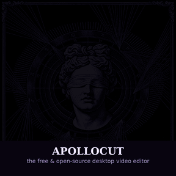

<p align="center">
  
</p>

<p align="center">
  <b>The free &amp; open-source desktop video editor that gives premiere editing back to everyone.</b><br>
  Non-linear timeline · keyframed effects · audio mixing · FFmpeg render engine — 100% local, 0€ forever.
</p>

<p align="center">
  
</p>

<p align="center">
  <a href="LICENSE"></a>
  
  
  <a href="https://esoexe.github.io/ApolloCut/"></a>
  <a href="https://github.com/esoexe/ApolloCut/stargazers"></a>
  <a href="https://github.com/esoexe/ApolloCut/releases"></a>
  
</p>

---

## Why ApolloCut?

Professional video editing has been locked behind subscriptions and fortress ecosystems for a decade. **ApolloCut is the counter-answer:** a desktop NLE shaped around the classic "timeline + program monitor + bins" workflow professionals already know — with no account, no telemetry, no cloud, and a license (MIT) that says it stays free, forever.

The blindfold in our icon isn't decoration. Editing tools shouldn't play favorites with your wallet.

## ⚡ Features

<table>
<tr>
<td valign="top" width="50%">

### Timeline & Editing
- Multi-track video **and** audio, drag & drop from OS or the project bin
- Blade, ripple-delete, detach audio, nested sequences
- Undo/redo, snapping, markers with labels, ripple trim
- J-K-L shuttle, razor, marquee select, track lock/mute/hide
- Autosave every 30 s (projects are plain JSON — no lock-in)

### Real-time Preview
- GPU-accelerated compositor (WebGL) with automatic CPU fallback
- Chroma key (green screen), transform, crop
- Text & title overlays

</td>
<td valign="top" width="50%">

### Effects & Keyframes
- Bezier easing on every keyframable property
- Adjustment layers: grade an entire stack at once
- Gaussian blur, noise, sharpen, saturation/vibrance, color wheels
- Source-panel preview before you commit a cut (3-point editing)

### Audio & Export
- Per-clip volume, pan, fades, fade-curve handles
- Solo/mute per track, master live meters
- Pro export via bundled FFmpeg engine: **H.264 / HEVC / ProRes / WebM**, plus WAV, MP3 & animated GIF
- Hardware fallback chain that never leaves you without a render

</td>
</tr>
</table>


## ♟ How it compares

| | Premiere Pro | ApolloCut | CapCut | Shotcut |
|---|---|---|---|---|
| **Price** | $22.99+/mo subscription | **free forever (MIT)** | free* (freemium tiers) | free (GPL) |
| **Account required** | yes | **no** | yes | no |
| **Telemetry / cloud calls** | heavy | **none — 100% local** | yes | none |
| **Watermark** | — | **never** | on some exports | never |
| **Multi-track NLE** | ✔ | ✔ | ✔ | ✔ |
| **Keyframed effects (bezier)** | ✔ | ✔ | partial | partial |
| **Nested sequences** | ✔ | ✔ | ✘ | ✘ |
| **Adjustment layers** | ✔ | ✔ | ✘ | ✘ |
| **Pro render engine (H.264/HEVC/ProRes)** | ✔ | ✔ bundled FFmpeg | partial (HEVC extra) | ✔ FFmpeg |
| **Headless CI render API** | ✘ | ✔ `hf-run-apollocut.js` | ✘ | partial (melt) |
| **Source code you can ship products with** | ✘ | ✔ MIT | ✘ | ✔ GPL (linked limits) |
| **Battle-tested for 15 yrs** | ✔ | ✘ (young & open) | partial | ✔ |

*Row for row, ApolloCut trades polish-years for freedom, privacy and price. That's the deal on the tin.*

## 📦 Download

Grab the Windows installer (99 MB, everything bundled — no dependencies needed):

👉 **[github.com/esoexe/ApolloCut/releases/latest](https://github.com/esoexe/ApolloCut/releases/latest)** → download `ApolloCut-Setup-1.3.3-x64.exe`

Releases are the official, permanent home of ApolloCut binaries — every version is built automatically from this exact source by GitHub Actions. Our website [esoexe.github.io/ApolloCut](https://esoexe.github.io/ApolloCut/) also points its download button at the newest Release automatically.

▶️ **Watch the promo** (12 s): [docs/promo.mp4](docs/promo.mp4) · Launching ApolloCut or writing about it? Everything you need is in [docs/LAUNCH-KIT.md](docs/LAUNCH-KIT.md).

📘 **New editor?** → [docs/TUTORIAL.md](docs/TUTORIAL.md) (first 10 minutes) · ⌨️ [docs/SHORTCUTS.md](docs/SHORTCUTS.md)

## 🔨 Build from source

```bash
git clone https://github.com/esoexe/ApolloCut.git
cd ApolloCut
npm install
npm start            # runs the app in dev mode
```

Build the Windows installer yourself:

```bash
npm run dist         # → release/ApolloCut-Setup-<version>-x64.exe
```

Requirements: Node 20+ and npm. No other system dependencies — Electron and FFmpeg binaries are fetched by npm automatically.

### CLI headless export

ApolloCut can also run inside CI as a headless renderer:

```bash
node hf-run-apollocut.js project.apollocut.json --nodes 1
```

## 🧠 Tech

| Layer | Stack |
|---|---|
| Shell | Electron 33 (single-instance, custom protocol, native menus) |
| Editor UI | Vanilla ES modules — zero framework, zero lock-in |
| Preview | WebGL compositor + CPU fallback |
| Render engine | FFmpeg (bundled, `ffmpeg-static` b6.1.1) — real H.264/H.265/ProRes |
| Projects | Readable JSON, autosave + manual `.apollocut.json` |

## 🤝 Contributing

Yes please. See [CONTRIBUTING.md](CONTRIBUTING.md) — bug reports, feature ideas and pull requests are all welcome.

## ⭐ Star history

[](https://star-history.com/#esoexe/ApolloCut&Date)

## License

[MIT](LICENSE) — free forever, for everyone. Take it, remix it, ship products with it. The only thing this license forbids is claiming you invented the wheel yourself.
